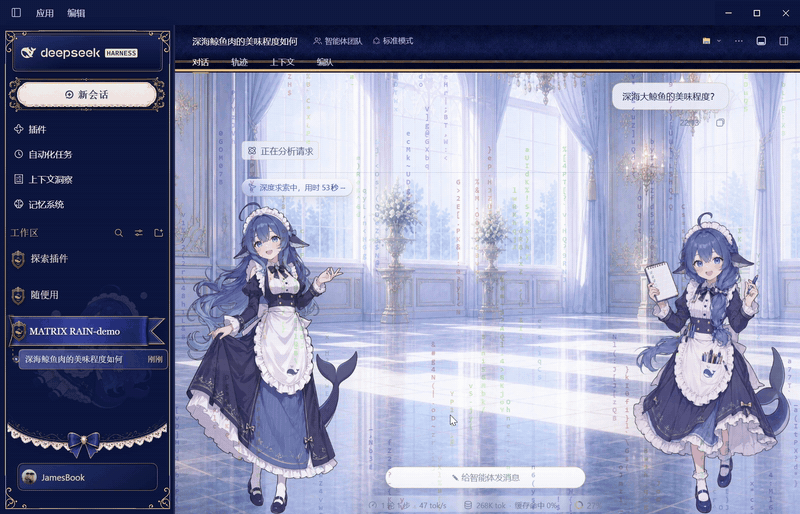
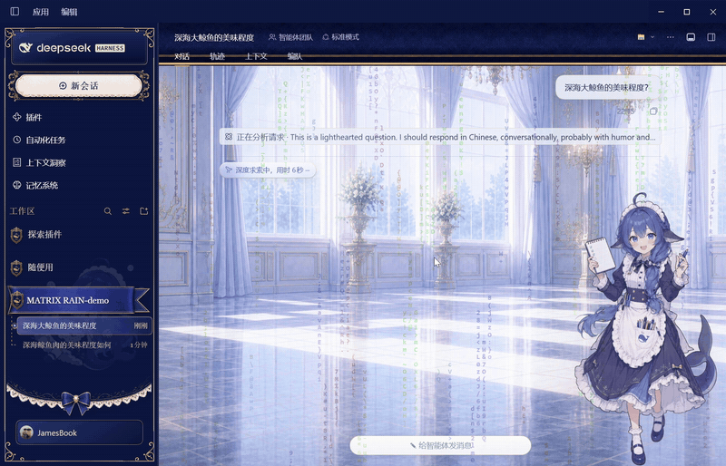
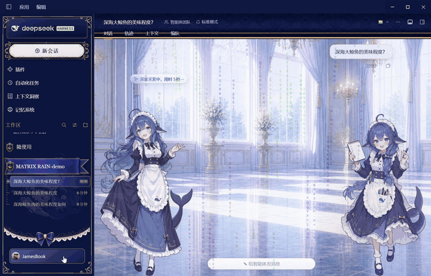

# dsh-matrix-rain · 矩阵雨动态皮肤

**DeepSeek Harness 的「黑客帝国字符雨」动态皮肤**——全屏程序化字符雨,左键任意位置激起物理冲击波。
独立运行,不依赖任何皮肤/第三方,可与任意皮肤叠加共存。

## 效果演示

**冲击波三连击** —— 经典绿 · 波速 15 · 字符被波前推飞后阻尼回弹



**任务运行时自动下雨** —— 仅任务模式 · TPS 自适应(144 tok/s 高速雨)



**设置页全览** —— 色轮 / 滑杆 / 即时预览,全部实时生效



## 特性

- **全屏程序化数字雨**:白头渐变尾、随机 glitch、火花,零静态素材
- **左键冲击波**:涟漪提亮 + 波前推力把字符推飞、阻尼回弹;波速独立可调,不随雨速变
- **鼠标光晕**:划过点亮附近字符
- **仅任务执行时下雨**:本工作区任意会话在跑即落(含后台会话),跨工作区不误触发
- **TPS 自适应**:雨速跟随任务吞吐;也可切手动倍率(50%~400%)
- **9 种色板 + HSL 色轮**自定义字符色;界面染色、背景衬色、雨幕区域裁剪
- 全部设置集中在 **设置 → 矩阵雨皮肤**,拖动即时生效

## 安装

```powershell
<DSH>\resources\runtime\cli\bin\dsh.cmd plugin --profile desktop add <本仓库本地路径>
```

装完在 **设置 → 插件** 确认 `dsh-matrix-rain` 已启用,刷新页面即见雨落。
(上架 npm 后可直接在插件市场搜索安装。)

## 配置

设置 → 矩阵雨皮肤:

| 项 | 说明 |
|---|---|
| 速度 | 手动倍率,或 TPS 跟随(跟谁开谁生效) |
| 冲击波速 | 5~120 px/帧,与雨速无关 |
| 色彩 | 9 色板 / 色轮自定义 / 界面染色 / 背景衬色 |
| 时机 | 随时 / 仅任务执行时 |
| 区域 | 全窗口 / 仅对话区 |

## 兼容性

- 实测 `@deepseek-ai/dsh` **0.2.0-rc.2**(桌面端)
- 不含 skin.json、不参与皮肤互斥:与任意皮肤(含官方默认)叠加共存,皮肤管理器互不感知

## 小贴士

- 遇到 web boot「import failed」致命框:是宿主启动审计的已知竞态误报,**重启即好**,别点「禁用第三方插件」
- 系统开「减少动态效果」时自动降级为静态画面;页面切到后台自动暂停
- 想要更强对比:浅色界面用深色字符 + 压印混合,深色界面随意
- 不想要了:设置 → 插件 一键禁用,界面立即复原

## 来源与许可

MIT。引擎移植自 Win32 GDI 屏保 `matrixrain.c v8`,视觉全部程序化生成,无第三方美术素材。
